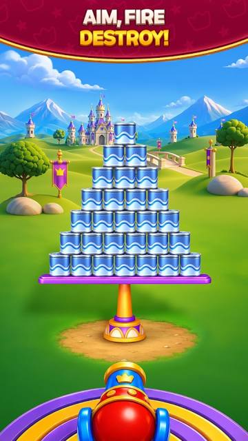
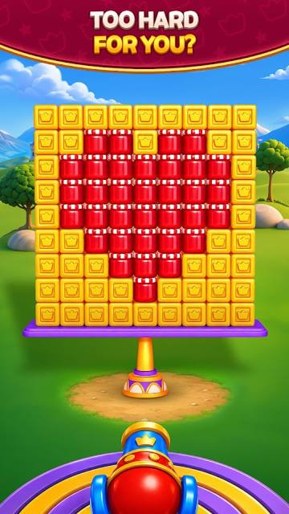
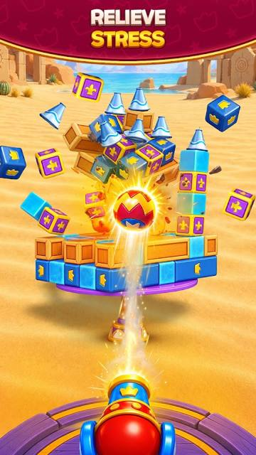
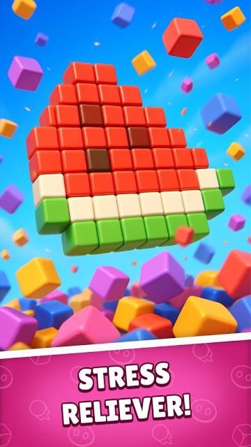
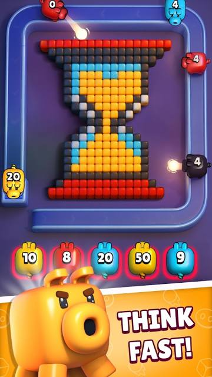
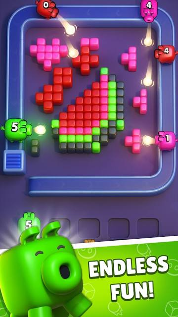

# Game ideas: 2026-11-18 (US Google Play)

## Idea A, EXACT CLONE: Pebble Pop Kingdom (working name)
**Based on:** [Royal Smash! - Physics Puzzle](https://play.google.com/store/apps/details?id=com.cyphergames.royalsmash&hl=en&gl=us) by Cypher Games   |   **Tags:** physics, cannon-aim, destruction, chain-reaction, level-based
**Why it works (proof):** 10M+ installs (about 15.5M real, Play data), 4.63 rating (523,890 ratings), released Jun 24 2026, updated 2026-11-18. US charts: Top Free #1 (Casual), Top Grossing #12. Estimated last-month downloads 1m-10m and revenue $1m-$10m (Sensor Tower public page, coarse band, confidence Med; grossing rank #12 supports the upper half of that band).
**Gameplay in 5 lines:** 1) Drag to set the cannon's angle and power. 2) Fire a ball into a 3D arena of jars, stone blocks and towers. 3) Win by smashing every target (or enough of them) with limited shots; lose when shots run out. 4) Levels move through themed arenas with heavier materials and more fragile structures. 5) Meta: coins, cannon/ball unlocks and arena progression.
**Monetization they use:** ads plus IAP ($0.99 to $399.99 per item), so rewarded video for extra shots and boosters, plus coin and cosmetic bundles.
**What we change (assets):** swap the royal theme for a toy workshop or a candy kingdom; new name, new cannon design, new smashable props (candy jars, gingerbread walls, jelly towers), new UI skin, new smash SFX and music. Name ideas: Pebble Pop Kingdom, Sugar Smash, Crumble Castle.
**Reference screens:**    
**Build estimate:** Med. Systems: drag-aim input, 3D physics (Unity or Godot), destructible props with HP and material types, chain-reaction scoring, level data, ads and IAP, coin economy. MVP: 30 levels, 1 cannon, 3 materials, rewarded-shot ad.
**Risks:** a 3D physics sim costs more than a 2D puzzle, level design carries the quality, a Jun 2026 hit may be near its peak, and Play review may flag assets that look too close to the original.

## Idea B, NEW TWIST: Mosaic Spinner (working name)
**Based on:** [Pixel Flow!](https://play.google.com/store/apps/details?id=com.loomgames.pixelflow&hl=en&gl=us) by Loom Games (twisting the "conveyor and queue" mechanic, also in Yarn Loop by Combo Game)   |   **Tags:** conveyor-queue, color-match, one-tap, ammo-capacity, hybrid-casual
**Why it works (proof):** Pixel Flow has 10M+ installs (about 14.2M real), a 4.51 rating (249,125 ratings), released Aug 18 2025 and updated 2026-11-17. US charts: Top Free #23, Top Grossing #8 (Puzzle). Estimated last-month downloads 500k-1m and revenue $1m-$10m (Sensor Tower public page, confidence Med). Yarn Loop uses the same loop: 1M+ installs, 4.49 rating, Free #14 / Grossing #7, same Sensor Tower bands. That shows the loop is a genre, not a one-off.
**Gameplay of the base game in 5 lines:** 1) Tap a pig in the queue to send it onto a conveyor around a pixel picture. 2) It shoots balls at cubes of its own color; the number over its head is its ammo. 3) Ammo spent means it leaves; ammo left means it parks in one of 5 waiting slots to be re-sent later. 4) The conveyor has limited capacity and slots are limited, so ordering matters; win by clearing the picture, lose when slots are full. 5) Meta: more pictures, boosters, and ad or IAP continues.
**The twist:** the pixel picture is on a turntable that rotates 90 degrees each time the conveyor completes a loop, so cubes buried on one side become exposed and the right ordering depends on which side faces the conveyor next.
**Why it should work:** it keeps the proven one-tap, queue-management loop and adds a visible, learnable timing rule, so every level has a "when" as well as a "which". It is also a cheap change, since the board is just a rotating grid, so a prototype fits well inside a week.
**Monetization:** same pattern as base (rewarded ads for extra slot or undo, IAP up to $99.99 in the base game): extra waiting slots, a "freeze rotation" booster, a starter pack.
**What we change (assets):** a museum-restoration theme: tile-setters in a queue restore a cracked mosaic. Name ideas: Mosaic Spinner, Tile Turn, Spin Restorer.
**Reference screens:**    
Wireframe of our screen (text):
```
[ Level 12 ]      [ coins ]
   _______________
  |   MOSAIC      |  <- circular turntable, rotates 90 deg per conveyor lap
  | (cubes, 4 sides, one side faces belt) |
   ---------------
 ==> conveyor belt (capacity 5) ==>
 [ waiting slots: _ _ _ _ _ ]
 [ queue: setter(3) setter(5) setter(2) ... ]
 [ boosters: +slot | freeze spin | undo ]
```
**Build estimate:** Low to Med. Systems: grid and cube HP model, conveyor path and capacity, queue and slots, turntable rotation rule, level generator from images, ads and IAP. MVP: 25 hand-made levels, 5 colors, 1 booster.
**Risks:** the genre is getting crowded (Pixel Flow and Yarn Loop are both in the top grossing) so a clear hook and quick-to-read creatives matter, ad costs may be high, and pure clones of the base are likely to be common.

**Recommendation:** build Idea B (Mosaic Spinner) first: it is cheaper (2D or light 3D, a one-week prototype) and rides a loop two separate hits already prove, while Idea A needs a heavier 3D physics build.

## Notes
- Revenue figures are coarse Sensor Tower public bands, not exact; confidence Med. Grossing rank is the secondary signal.

## Questions for you
- Do you prefer 2D low-cost builds (like Idea B) or are 3D physics builds (Idea A) in scope? Default used: both shown, B recommended.
