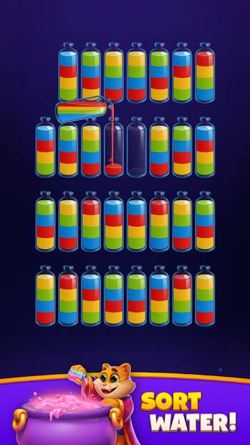
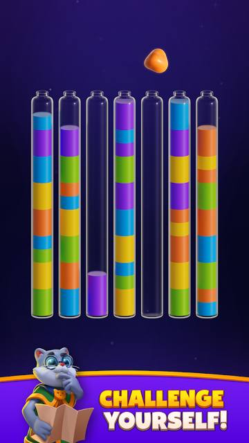
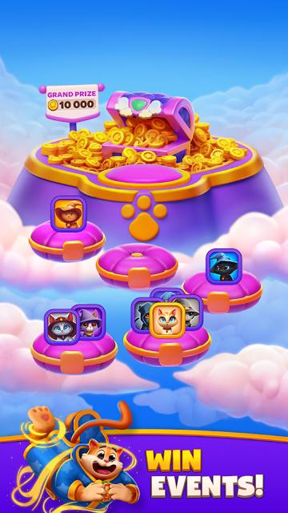
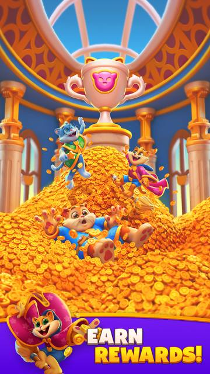
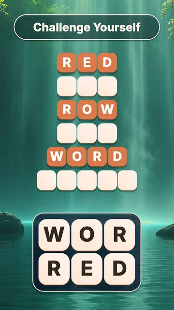
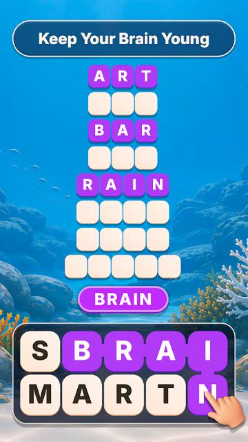
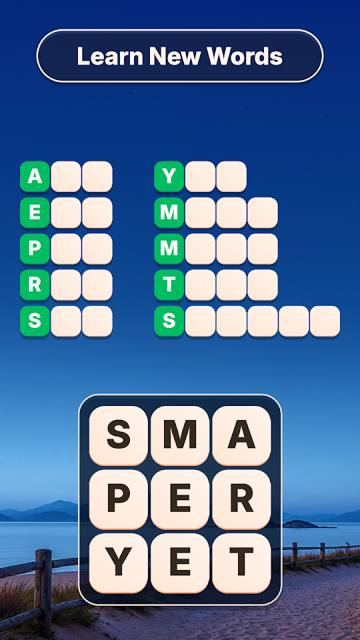
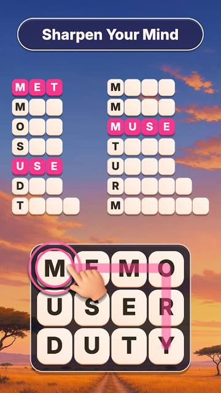

# Game ideas: 2026-11-19 (US Google Play)

Data: charts snapshot 2026-11-19 (US Top Free + Top Grossing), Play Store listing via google-play-scraper, Sensor Tower public bands. Revenue = coarse **estimate**, not actuals.

## Idea A, EXACT CLONE: Potion Pour Pals
**Based on:** [Magic Sort!](https://play.google.com/store/apps/details?id=com.grandgames.magicsort&hl=en&gl=us) by Grand Games A.Ş.   |   **Tags:** water-sort, color-sort, tap-pour, undo/shuffle boosters
**Why it works (proof):**
- Installs: 10M+ listed (scraper realInstalls ≈ 47.8M); rating 4.54 (655,902 ratings)
- Released Jun 26, 2024; last updated 2026-11-15 (v0.0.3480), so still actively live-opsed
- US chart ranks today: Top Free #7 / Top Grossing #14 (Puzzle)
- Est. monthly downloads $-free: 1m-10m; est. monthly revenue **$1m-$10m** (Sensor Tower public band, confidence Med; Top Grossing #14 supports the upper-middle of that band)
- Caveat: older than 6 months, so the genre is saturated; included because it is simple, proven and still top 15 in grossing.

**Gameplay in 5 lines:**
1. Tap a bottle to lift it, tap another to pour.
2. Pour is legal only if the target's top colour matches (or it is empty) and there is room.
3. Win: every bottle holds a single colour. Lose: stuck (no legal pours) → use boosters or restart.
4. Levels grow: more colours, more bottles, hidden/mystery layers, extra rows, pre-filled tricky starts.
5. Meta: coins, themed bottles/backgrounds, daily rewards, event levels.

**Monetization they use:** interstitial + rewarded ads (undo, shuffle, extra bottle), IAP $0.99-$199.99 (coin packs, no-ads, booster bundles). Contains ads: yes.
**What we change (assets):** brand-new theme: tiny potion-brewing creatures (frogs/mushroom sprites) pouring glowing potions in a cozy apothecary shop; new bottle shapes, colour palette with colour-blind symbols, new UI kit, new SFX (bubbly gloops), new music. Name ideas: Potion Pour Pals, Brew Sort, Gloop Shelf.
**Reference screens:**    
**Build estimate:** Low. Systems: bottle/liquid renderer (stack of colour segments + pour animation), move validator, level generator with solvability check, undo/shuffle/add-bottle boosters, ads + IAP SDK, level progression/save. MVP: 100 generated levels, 3 boosters, rewarded-ad hooks, one theme.
**Risks:** very saturated category (many clones, high UA cost); hard to differentiate beyond art; need good level-difficulty curve and strong retention events to monetise; avoid copying their bottle art/cat mascot.

## Idea B, NEW TWIST: Word Avalanche
**Based on:** [Word Tiles - Relaxing Puzzle](https://play.google.com/store/apps/details?id=com.agavegames.wordtiles&hl=en&gl=us) by Agave Games   |   **Tags:** word-stack, letter-grid, swipe-spell, gravity (twist)
**Why it works (proof):**
- Installs 1M+ listed (scraper realInstalls ≈ 2.7M); rating 4.86 (80,423 ratings)
- Released Jul 24, 2026 (4 months old), last updated 2026-11-13
- US chart ranks today: Top Free #1 (Word) / Top Grossing #8 (Word)
- Est. monthly downloads 1m-10m; est. monthly revenue **$50k-$100k** (Sensor Tower public band, confidence Low: it contradicts the Top Grossing #8 word rank, so the true figure is probably higher; treat as unknown)
- Fresh, high-rated hit still climbing = strong signal for the mechanic.

**Gameplay of the base game (from screenshots + listing; some details inferred):** a small letter grid sits at the bottom; the player swipes through adjacent tiles to spell words that fill the stacked slots above (e.g. 3-, 3-, 4-, 5-letter slots). Fill all slots to clear the level over calm nature backgrounds.
**Monetization they use:** ads + IAP $1.99-$49.99 (hints/coins, no-ads). Contains ads: yes.
**The twist:** after each word is spelled, its tiles are **removed and the remaining letters fall with gravity**, so the order you spell words decides which later words stay possible.
**Why it should work:** keeps the proven calm, low-text word loop but turns it from "find all words" into a light planning puzzle (like Tetris-style sequencing), which gives fresh levels, a natural hint/undo monetisation point, and a clear marketing hook ("don't collapse your own letters"). One rule change, no new UI to learn.
**What we change (assets):** theme of a snow-slope/mountain: letters are snowy rocks that tumble down; new art, name, audio; do not reuse their nature photo backgrounds or tile style.
**Reference screens:**    
**Wireframe of our screen (text):**
```
[ Level 12 ]            [ hint ]
 _ _ _        <- slot 3 letters
 _ _ _ _      <- slot 4 letters
 _ _ _ _ _    <- slot 5 letters
 ┌─┬─┬─┬─┐
 │S│T│A│R│   swipe adjacent tiles to spell;
 ├─┼─┼─┼─┤   spelled tiles vanish, columns
 │O│N│E│ │   drop down (gravity)
 └─┴─┴─┴─┘   [undo] [shuffle-rest]
```
**Build estimate:** Low-Med. Systems: grid + swipe input, dictionary lookup, gravity/collapse animation, level generator with solvability solver (words must be spelled in some valid order: the hard part), hints/undo, ads+IAP. MVP: 60 hand-verified levels, 4x4 grid, one theme, prototype in about 1 week.
**Risks:** level generation/solvability is harder than in the base game (need a solver); dictionary/profanity filtering; the base game is only 4 months old so may be cloned heavily; twist might raise difficulty, so playtest.

## Questions for you
- Same open question from yesterday still stands (see data/questions.md: 2D-only builds vs 3D physics).

**Recommendation:** build **Idea B (Word Avalanche)** first: newer proven hit (Top Free #1), cheap 2D build, and the twist is testable in a week; Idea A is a safe but saturated backup.
