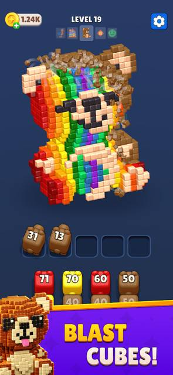
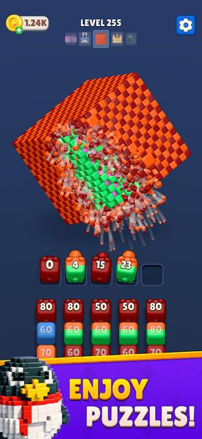
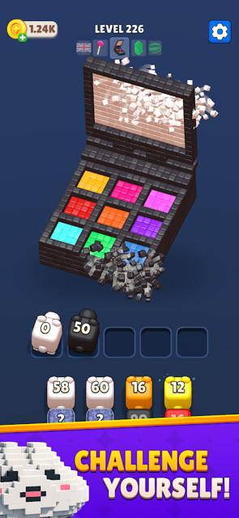
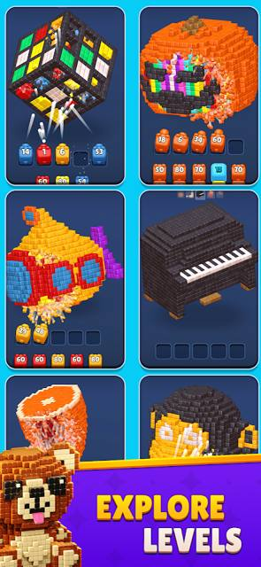
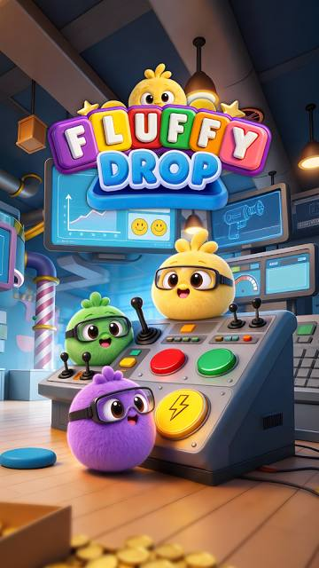
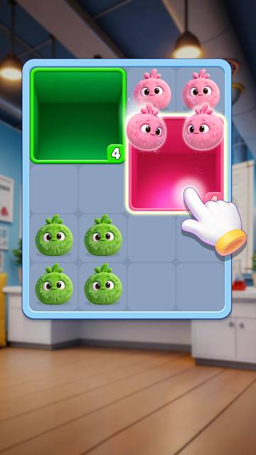
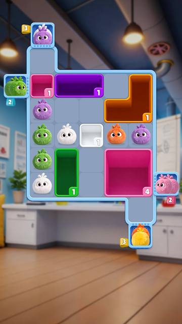
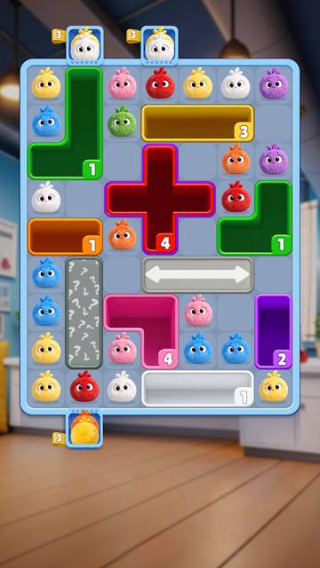

# Game ideas: 2026-11-20 (US Google Play)

## Idea A, EXACT CLONE: Blockbuster Bots
**Based on:** [Cube Land Puzzle Game](https://play.google.com/store/apps/details?id=com.rotatelab.cubeblast&hl=en&gl=us) by Rotatelab Yazilim ve Bilisim A.S.   |   **Tags:** voxel-3d, tap-shooter-queue, color-match, rotating-cube
**Why it works (proof):** 4.5M+ real installs (Play badge 1M+), 4.5 rating (75,484 ratings), released Jan 16 2026, updated Nov 13 2026. US chart ranks 2026-11-20: Top Free #2 (Puzzle), Top Grossing #15. Est. last-month downloads 500k-1m and revenue $1m-$10m (Sensor Tower public band; confidence Med: coarse band, but the Grossing #15 rank supports the upper half).
**Gameplay in 5 lines:** A 3D voxel sculpture (cube, snowman and so on) sits on screen and can be rotated. Below it is a grid of colored shooters, each showing an ammo number. Tap a shooter and it moves into a 5-slot queue and fires at blocks of its own color on the sculpture. A shooter at 0 ammo disappears. You lose if the queue fills with no useful shooters. Clear the sculpture to win. Levels are short, with new shapes and colors, and shooter grids are unlocked in column order.
**Monetization they use:** IAP $0.99-$99.99 (coins and boosters), a "no ads" claim in the Play data (containsAds=false), and likely rewarded video. Coin currency is used for extra queue slots and shuffles.
**What we change (assets):** Theme is tiny robots and toy bricks (name: Blockbuster Bots). Hand-drawn chunky voxel robots, a neon arcade UI, and new SFX and music. The sculptures are our own set (dinosaurs, rockets, food trucks). New name, icon and shooter art.
**Reference screens:**    
**Build estimate:** Med. Systems: voxel mesh renderer with instancing, orbit rotation, shooter queue and ammo logic, level data pipeline (voxel models to levels), coin shop, booster set, remote config. MVP: 30 levels, 1 theme, rewarded-video boosters, in Unity.
**Risks:** Same family as Pixel Flow (Idea B on 11-18), so the genre is getting crowded. A content treadmill (new sculptures weekly). Ad and UA costs are rising. Keep the IP distinct: do not copy their sculptures or shooter art.

## Idea B, NEW TWIST: Drifting Pom-Poms
**Based on:** [Fluffy Drop - No Timer](https://play.google.com/store/apps/details?id=com.fluffydrop.op.gp&hl=en&gl=us) by UniRise Studio   |   **Tags:** drag-drop-sort, color-bins, capacity-bins, moving-bins
**Why the base works (proof):** 5.26M real installs (Play badge 5M+), 4.37 rating (20,392 ratings), released Mar 29 2026, updated Nov 16 2026. US ranks: Top Free #3, Top Grossing #11 (Trivia category tag, though it is a puzzle). Est. last-month downloads 100k-500k and revenue $5k-$50k per Sensor Tower public band; confidence Low, because the Grossing #11 rank suggests the real figure is higher than the band.
**Gameplay in 5 lines:** A board holds fluffy colored balls and colored bins, each bin showing a capacity number. Drag balls into the bin of the matching color. A full bin pops and frees space. Clear all balls to win. Levels grow with more colors, blockers and tighter space. Meta: levels, coins and boosters.
**Monetization they use:** ads (interstitial and rewarded) plus IAP $0.99-$39.99.
**The twist:** After every move, each bin slides one cell along its own marked track, so you plan where a bin will be, not where it is.
**Why it should work:** It keeps the proven drag-and-drop sorting loop and adds a readable timing layer (like a conveyor, a mechanic players already like in Pixel Flow) without a timer, which Fluffy Drop markets as stress-free. The twist can be tested in a few days with a grid and 20 hand-made levels.
**What we change (assets):** Pom-pom critters in a night-market theme, with bins as lanterns and tracks as strings. New name, art, UI and audio.
**Reference screens (base game):**    
**Our twisted screen (text wireframe):**
```
[ Level 12 ]            [ coins ]
 .----track----------.
 | (Red lantern 4) -> |   <- arrows show the next cell
 '--------------------'
 .----track----.
 | (Blue 3) ->  |
 '--------------'
 [ ball tray: o o o o o ]   drag a ball onto a lantern
 Move counter: 3   (bins shift +1 per move)
```
**Build estimate:** Low. Systems: grid with draggable balls, bin tracks and a move-step tick, level editor, booster set (freeze bins, undo), ads SDK. MVP: 25 levels, 1 theme, in Unity.
**Risks:** The twist can feel fiddly on small screens (needs clear arrow telegraphing). The base game is mid-grossing, so the monetization ceiling is uncertain. Needs hard testing of level fairness.

## Questions for you
- Already open in data/questions.md: 2D cheap builds vs 3D builds. I defaulted to one 3D-voxel clone (A) and one cheap 2D twist (B).

**Recommendation:** Build B (Drifting Pom-Poms) first: Low build effort, testable within a week. If you want a bigger bet, A has far stronger revenue proof ($1m-$10m band, Top Grossing #15).
