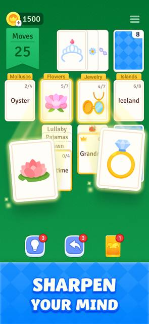
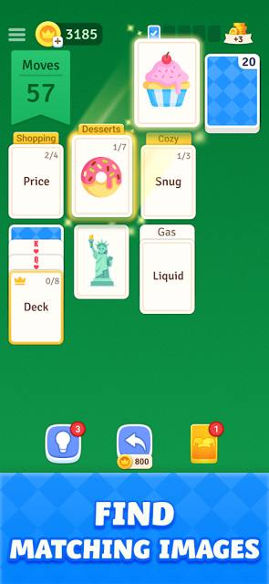
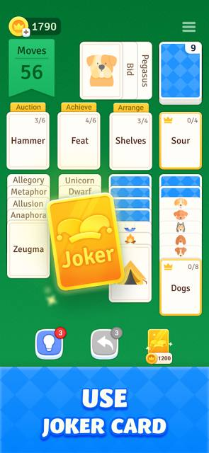
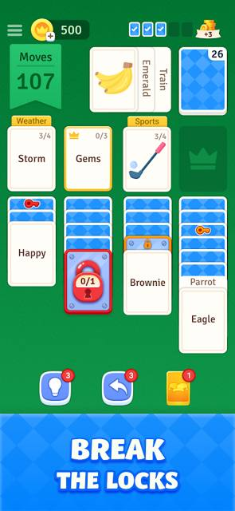
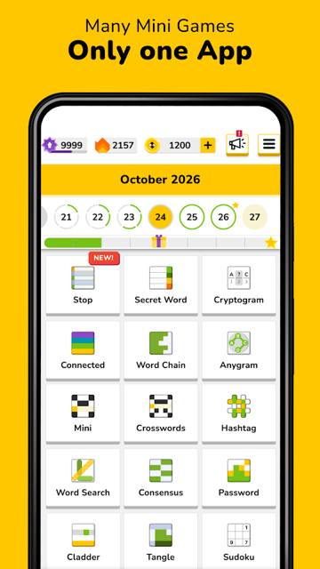
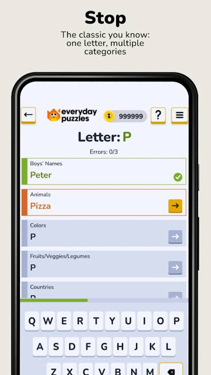
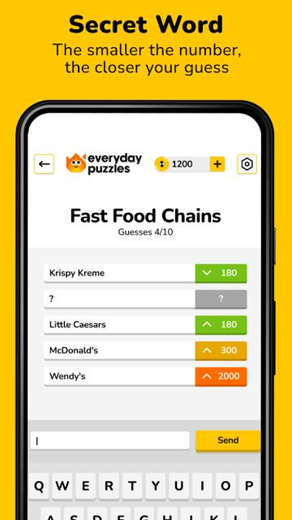
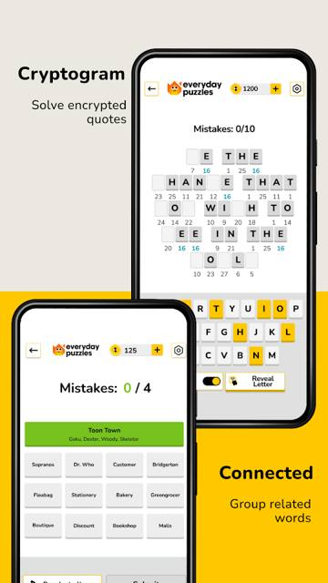

# Game ideas: 2026-11-21 (US Google Play)

## Idea A, EXACT CLONE: Category Crown Solitaire
**Based on:** [Solitaire Associations Journey](https://play.google.com/store/apps/details?id=com.hitappsgames.wordsolitaire&hl=en&gl=us) by Hitapps Games   |   **Tags:** word-solitaire, category-sort, card-stack, word-association
**Why it works (proof):** 10M+ listed installs (store counter; scraper realInstalls ~37.2M), rating 4.38 (485,253 ratings), released Aug 28 2025, updated 2026-11-20 (v1.27.0, actively live-opsed). US chart 2026-11-21: Top Free #5 / Top Grossing #1 in Word. Sensor Tower public bands, last month: downloads 1m-10m, revenue $1m-$10m (estimate, confidence Med; the Grossing #1 rank in its category suggests the upper part of the band).
**Gameplay in 5 lines:** Solitaire layout of word cards plus a draw pile → tap/drag a card onto a category header (e.g. "Flowers", "Jewelry") → a category needs N matching cards (e.g. 5/7) to complete → clear all cards within a move limit to win; running out of moves loses → levels add more categories, "mixed" decoy cards and harder associations → coins buy hints/undo/extra moves.
**Monetization they use:** interstitial + rewarded ads (hint, undo, extra moves), coin packs and offers IAP ($0.99 - $129.99). Ads flag: yes.
**What we change (assets):** new name, new theme (a royal "crown" collection theme but with our own art: pastel illustrated cards, no copied card faces or category icons), own category word lists, own UI/colours (e.g. warm cream and plum instead of green felt), new SFX. Name ideas: Category Crown, Sort & Sage, Kindred Cards.
**Reference screens:**    
**Build estimate:** Low-Med. Systems: card stack and drag/tap UI, category slots with counters, move counter, hint/undo/shuffle, level data (JSON word sets), coin economy, ads/IAP SDK, remote level config. MVP: 60 hand-written levels, 3 boosters, rewarded-ad hint.
**Risks:** content treadmill (category lists must be fresh and clean, ideally LLM-assisted and human-checked); crowded Word category and cloners; ad-cost-heavy UA; keep wording lists original to avoid closeness.

## Idea B, NEW TWIST: Rare Words Daily
**Based on:** [Everyday Puzzles: Mini Games](https://play.google.com/store/apps/details?id=com.fanatee.keep&hl=en&gl=us) by Fanatee (daily word-puzzle hub, streaks) with the rarity-scoring idea seen in early-stage [Krakio](https://play.google.com/store/apps/details?id=com.krillion.app&hl=en&gl=us)   |   **Tags:** daily-puzzle, streak, word-hub, rarity-score
**Why the base works (proof):** Everyday Puzzles: 10M+ installs (realInstalls ~10.9M), 4.55 (99,205 ratings), released Jan 19 2022, updated 2026-11-13; US Top Free #1 / Top Grossing #2 in Trivia on 2026-11-21. Sensor Tower public bands last month: downloads 100k-500k, revenue $5k-$50k (confidence Low: it conflicts with Free #1 / Grossing #2 ranks, so treat as a floor). Krakio signal is weak: 50k+ installs, 378 ratings, released Oct 22 2026 (a one-month-old test, not proof).
**The twist:** every daily puzzle is a "name something" prompt with many valid answers, and your score is how rarely other players chose the same answer, shown as a shareable "uniqueness %" card.
**Why it should work:** keeps the proven loop (one daily session, streak, archive, share) but adds a social comparison that existing hub games lack, and it is spoiler-free and highly shareable. Cheap content: prompts instead of fixed solution grids.
**Gameplay in 5 lines:** open today's 5 prompts (e.g. "Name a fruit that is yellow") → type or pick one answer in 20s → server tallies how many players gave the same → rare-but-valid answers score more, invalid ones score 0 → streak flame and XP ladder → share card with uniqueness % and compare with friends.
**Monetization:** rewarded ads for extra time/retry, streak freeze IAP, archive/unlimited-play subscription (the same model as the base hub; their IAP range $0.99 - $49.99, ads: yes).
**What we change (assets):** original brand, "fingerprint" visual identity, own prompt bank, own UI.
**Reference screens:**    
Wireframe of our screen: `[Day 12 flame]  Prompt: "Name a yellow fruit"  [ type answer ____ ]  timer 20s` → result: `You: "Starfruit" · only 3% said this · +90` plus a bar of the top 5 answers and a Share button.
**Build estimate:** Low-Med. Systems: daily prompt feed, answer normalisation/synonym merge (fuzzy match plus LLM check), small backend counter, streaks, share-card image. MVP: 5 prompts/day, 90 days of seeded prompts, no accounts.
**Risks:** needs player volume for meaningful rarity (seed with simulated distribution at launch); moderation of free-text answers; the base's monetization is only partially proven (revenue band is Low confidence).

## Questions for you (only if truly needed)
- Open question from 2026-11-18 (2D cheap vs 3D builds) is still unanswered; today's picks are both 2D.

**Recommendation:** build Idea A first: it has the strongest proof (Grossing #1 in Word, ~485k ratings) and a Low-Med build, while Idea B has a cheaper but unproven social twist and is a good 1-week prototype second.
