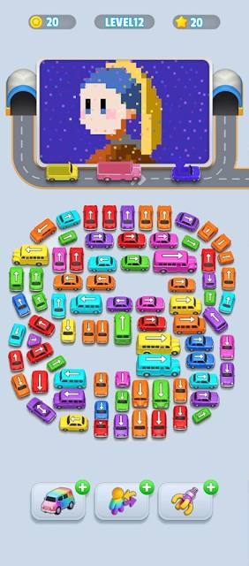
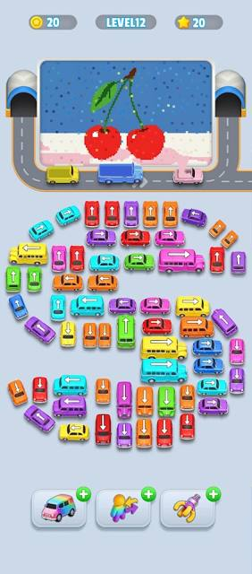
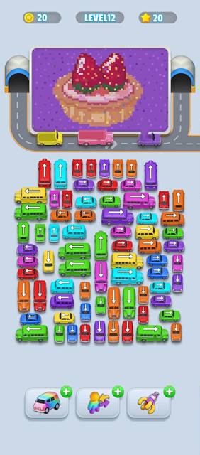
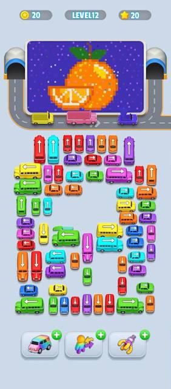
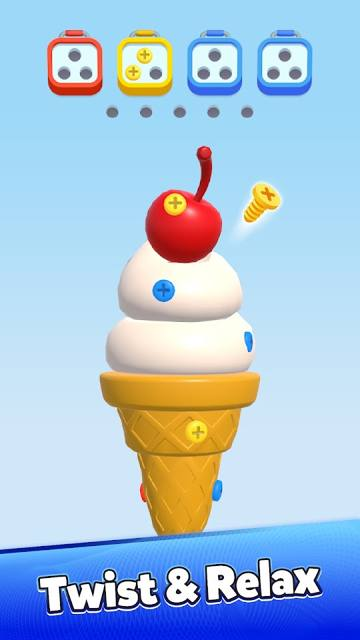
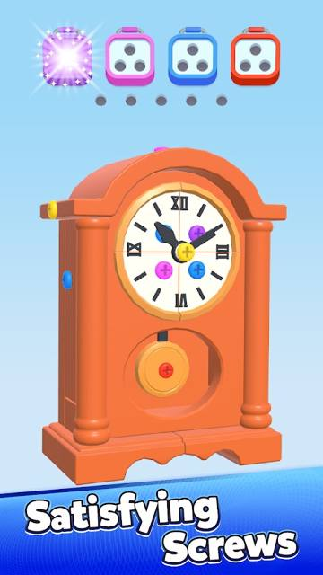
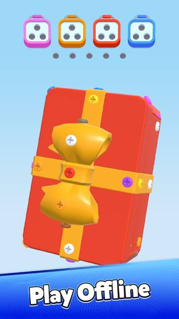
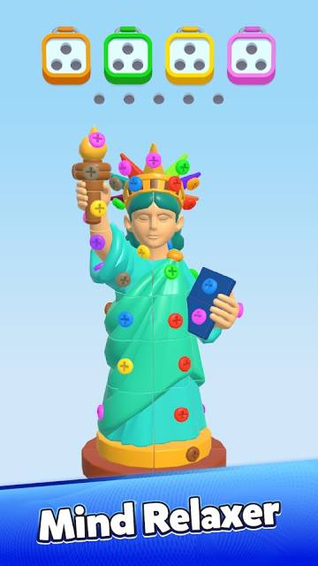

# Game ideas: 2026-11-22 (US Google Play)

## Idea A, EXACT CLONE: Sprinkle Shuttle
**Based on:** [Jam Bus:Sandfall](https://play.google.com/store/apps/details?id=bus.sand.fall.jam.loop.traffic.flow&hl=en&gl=us) by Nova Games Technology Limited   |   **Tags:** bus-jam, sand-layers, traffic-escape, tap-route, color-match
**Why it works (proof):** 1M+ listed installs (store counter; scraper realInstalls ~3.65M), rating 4.79 (92,061 ratings), released Jun 17 2026 (about 5 months old), updated 2026-10-23 (v37.0, so heavy live-ops). US chart 2026-11-22: Top Free #17 / Top Grossing #23 in Casual. Sensor Tower public bands, last month: downloads 1m-10m, revenue $500k-$1m (estimate, confidence Med; the Grossing #23 rank is consistent).
**Gameplay in 5 lines:** Board of parked, color-coded buses each with an arrow/route → tap a bus and it drives out along its route → it collects the matching-color sand from a layered "sand picture" at the top (lower layers must be cleared first) → buses that block or cross paths crash/jam, so you must plan the tap order; win by clearing the whole picture → levels add more buses, tighter routes, more sand layers and bigger pictures → coins buy boosters (extra bus, shuffle, grab).
**Monetization they use:** interstitial + rewarded ads, coin packs/offers IAP ($0.99 - $99.99), booster purchases. Ads flag: yes.
**What we change (assets):** new theme: little ferries/shuttles/mail-vans in an original art style delivering "sprinkles" (or beads/confetti) to fill a pixel mosaic of food/animals; new UI palette, new sounds (soft clicks, sprinkle ASMR), own level data. Name ideas: Sprinkle Shuttle, Bead Bus, Confetti Convoy.
**Reference screens:**    
**Build estimate:** Low-Med. Systems: grid/route vehicle movement and blocking logic, layered picture and fill system, level generator + solver for solvable levels, 3 boosters, ads/IAP SDK, remote level config. MVP: 50 levels, 2 boosters, rewarded-ad retry.
**Risks:** "bus/car jam" genre is already crowded with clones; ad-cost-heavy UA; level design needs a solver to guarantee solvability; keep the art and theme clearly distinct from the original.

## Idea B, NEW TWIST: Swap Shop Screws
**Based on:** [Screw Out 3D: Nut Sort Jam](https://play.google.com/store/apps/details?id=net.happywit.screw.out.jam&hl=en&gl=us) by Unico Studio   |   **Tags:** screw-puzzle, unscrew-order, color-tray-sort, 3d-object, build-meta
**Why the base works (proof):** 5M+ installs (realInstalls ~5.1M), rating 4.65 (258,754 ratings), released Aug 13 2025, updated 2026-09-29. US chart 2026-11-22: Top Free #22 in Puzzle (new entry in our chart, no Grossing rank). Sensor Tower public bands, last month: downloads 500k-1m, revenue $100k-$500k (estimate, confidence Med-Low; no Grossing rank to cross-check).
**The twist:** unscrewing object A releases its parts into a build tray, and those same parts are the kit you re-screw into a second, different object B, so every level is "take apart one thing to build another".
**Why it should work:** keeps the proven satisfying unscrew loop and color-tray sorting, adds a visible goal (the object you are building) and a collection meta (a shelf of rebuilt objects) that plain unscrew games lack; a one-week prototype is only unscrew + tray + snap-to-slot.
**Gameplay in 5 lines:** tap a screw to unscrew it, freeing the plate it holds → freed parts drop into a limited tray, if the tray fills you lose → drag parts from the tray onto glowing slots of object B and tap to screw them in → finish B to win and add it to your shelf → later levels add stuck/locked screws, bigger objects and tray limits.
**Monetization:** rewarded ads (extra tray slot, undo), interstitials between levels, booster packs and no-ads IAP ($0.99 - $99.99 per the base game; ads: yes).
**What we change (assets):** original low-poly "toy workshop" look, own objects (toy robot to music box etc.), own UI and sounds; shelf as the collection meta.
**Reference screens:**    
Wireframe of our screen: `TOP: [Object A being dismantled, screws highlighted]  MID: tray [ ][ ][ ][ ][ ] (5 slots)  BOTTOM: [Object B ghost outline with glowing slots, parts counter 4/9]`.
**Build estimate:** Med (3D objects). Systems: 3D screw/part removal with blocking logic, tray with capacity, drag-to-slot assembly, shelf meta, ads/IAP. MVP: 30 levels, 6 reusable object kits (2D-style or simple 3D keeps it cheap).
**Risks:** 3D art per level is a content cost (partly lowered by reusing parts across objects); unscrew genre is crowded; the extra assemble step could slow the "quick relaxing" feel, so test session length in the prototype.

## Questions for you (only if truly needed)
- Still open from 2026-11-18: 2D-only builds, or are 3D builds in scope? (Default: both allowed; today B is 3D-light.)

**Recommendation:** build Idea A (Sprinkle Shuttle) first: higher proven revenue, a Top Grossing rank and a cheap 2D build, while B needs 3D content and has an unproven revenue band.
