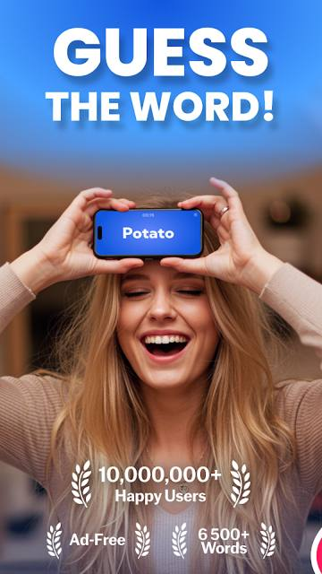
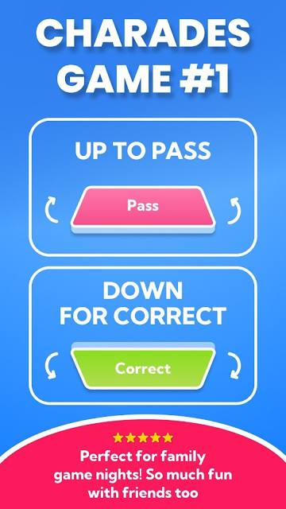
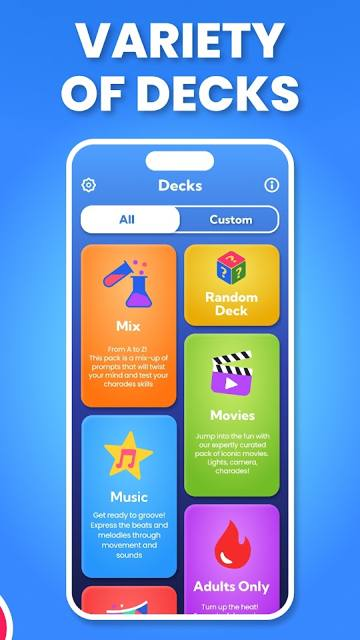
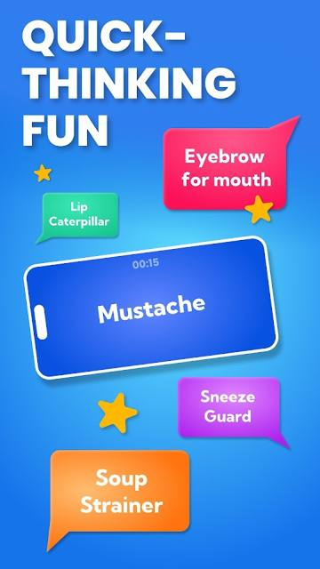
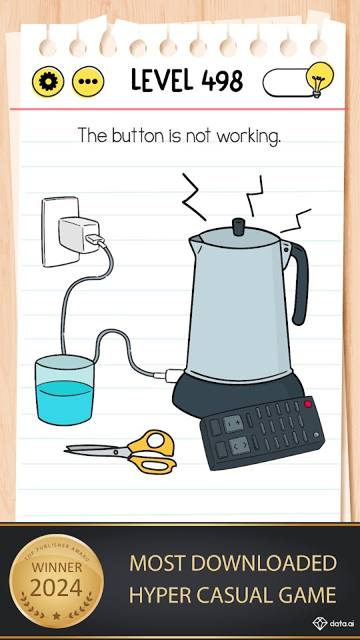
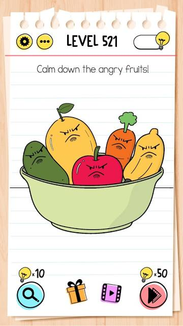
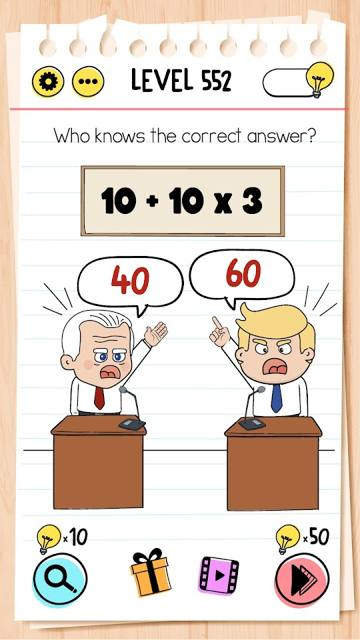
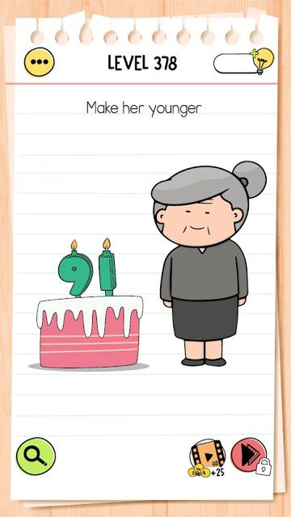

# Game ideas: 2026-11-23 (US Google Play)

## Idea A, EXACT CLONE: Noggin Noodle (party headband charades)
**Based on:** [Charades Guess Game — Guessly](https://play.google.com/store/apps/details?id=io.smakapps.guessly&hl=en&gl=us) by smak apps   |   **Tags:** party, charades, heads-up, tilt-sensor, deck-packs
**Why it works (proof):**
- Installs: 1M+ listed, ~4.15M real (scraper). Rating 4.65 (79,854 ratings). Released Mar 30, 2026, updated 2026-10-21 (v1.9.0).
- US chart (2026-11-23): Top Free #12, Top Grossing #12 (Play Store charts, High confidence).
- Estimate: ~1m-10m downloads and $100k-$500k revenue last month (Sensor Tower public band, Med-Low confidence; the Grossing #12 rank suggests the upper part of the band or higher).
- Notable: no ads, monetizes purely via IAP/subscription, and still ranks in Grossing. About 8 months old.

**Gameplay in 5 lines:**
1. Pick a deck (48 decks, 6,500+ prompts), hold the phone to your forehead so friends see the word.
2. Friends give clues; you guess the word aloud before the timer ends (about 60 s).
3. Tilt down = correct, tilt up = skip (accelerometer).
4. Round score = correct count; players pass the phone round-robin.
5. Meta: unlock more decks via purchase, seasonal and themed decks, group-play sessions.

**Monetization they use:** no ads. IAP range $7.99-$49.99 per item (deck bundles or subscription or lifetime unlock; exact split not verified). Paywall after the free decks.
**What we change (assets):** new name (Noggin Noodle), a goofy noodle-character mascot, a bright street-food visual theme, our own prompt lists (written from scratch, not copied), new tilt sounds and buzzer, our own deck names (Foodie Frenzy, Movie Night, Animal Mimic, Office Chaos).
**Reference screens:**    
**Build estimate:** Low. Systems: deck data (JSON), timer, accelerometer tilt detection, score screen, paywall and IAP, local pass-and-play. MVP: 6 decks of 100 prompts plus tilt gameplay in about 1 week.
**Risks:** content treadmill (needs steady new decks), copycat-heavy genre (Heads Up!), no ads means monetization depends on a good paywall, prompt IP (avoid trademarked names), tilt sensors vary across devices.

## Idea B, NEW TWIST: Trap Door Trials (friend-made trick puzzles)
**Based on:** [Brain Test: Tricky Puzzles](https://play.google.com/store/apps/details?id=com.unicostudio.braintest&hl=en&gl=us) by Unico Studio   |   **Tags:** trick-puzzle, brain-teaser, ugc-levels, share-link
**Why it works (proof, for the base mechanic):**
- Installs: 100M+ listed, ~396M real. Rating 4.73 (10.1M ratings). Released Nov 2019, updated 2026-11-05.
- US chart (2026-11-23): Top Free #1, Top Grossing #9 (Play Store charts, High confidence).
- Estimate: Sensor Tower public bands show 1m-10m downloads and $5k-$50k revenue last month, which looks too low next to Grossing #9 (Low confidence on revenue; I do not have a better number).
- Contains ads plus IAP ($0.99-$7.99): ad-skip plus hint/skip purchases.

**Gameplay in 5 lines (base):** one-screen riddle with a hidden trick (e.g. "tap the title", "turn the phone") → one tap or gesture → right answer advances, wrong answer shows a funny fail → about 100s of levels → hints and skip via rewarded ad.
**The twist:** players build their own 20-second trick level from 8 drag-drop templates (hidden tap zone, fake button, tilt answer, reverse text, etc.) and send it to friends as a link; the creator earns coins by how many friends they fool.
**Why it should work:** it keeps the proven fun of "ha, I fell for it" but makes content free (players write the levels, removing the content treadmill) and adds a built-in viral share loop, which Brain Test lacks.
**Monetization:** rewarded ads for hints, interstitials between levels, IAP for template packs and ad removal.
**What we change:** original riddle ideas and art, a cartoon "game show host" mascot, new name.
**Reference screens:**    
**Our twisted screen (wireframe):**
```
[Builder]  Template tray: [Fake btn][Hidden tap][Tilt][Flip text][Timer]
+------------------------+
| Q: "Press the red btn" |   <- creator drags a fake red button
|   [ RED ]  (fake)      |   <- real answer: tap the "Q" letter
+------------------------+
[Test it]  [Send link]  Fooled: 12 friends = +120 coins
```
**Build estimate:** Med. Systems: 8 template engines, level serializer to short link (backend or deep link with encoded JSON), play screen, coin economy, ads/IAP. MVP: 5 templates, share via Android intent, no accounts, about 1 week for the prototype.
**Risks:** moderation of UGC (keep it text-light with canned prompts), cold start (seed with 100 own levels), Brain Test is a big franchise with ad budget, IP closeness (use original riddles and art only).

## Questions for you (only if truly needed)
- Open question still pending in data/questions.md (2D vs 3D builds). Default used: cheap builds only (both ideas today are 2D, low-to-medium effort).

**Recommendation:** Build Idea A (Noggin Noodle) first: lowest build effort (about 1 week), proven by a young app that ranks Grossing #12 with no ads, and no art-heavy assets. Prototype B after if you want a viral loop.
